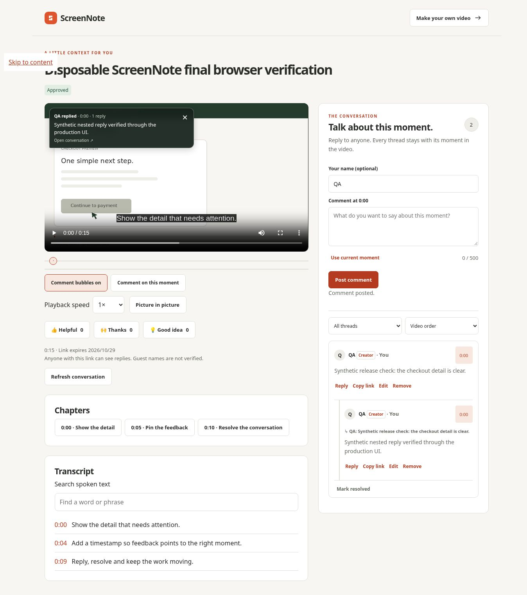
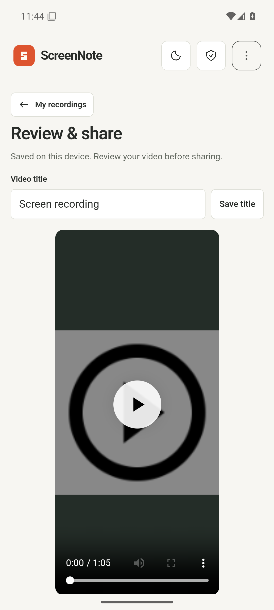
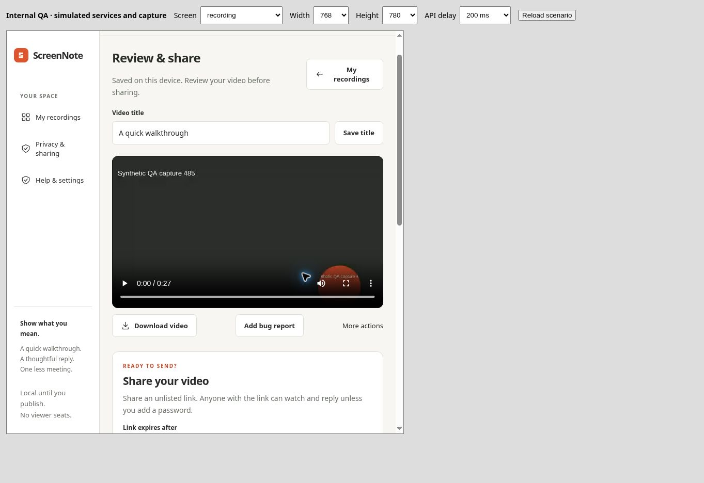

# ScreenNote recording and workspace verification

Audit and repair performed 27–28 October 2026 (Africa/Johannesburg). Scope: recording capacity, local editing/export, sharing, workspace usability, feedback, recovery and Android regression testing.

## Release identity

- Main implementation: PR #3, merged as `294b986a054588f682e1446fae100288cc7a1505`; tested candidate `96b152757852c356750146d2b1e8a002a486fa91`.
- Later title/contrast fixes from the parallel product audit were preserved: merge `5258def498917a186ce276731377810c6c46a952`. They were retrieved from main, inspected and included in the local 111-test run.
- Added bounded production acceptance workflow and enhanced smoke script: `b9d785bac01de5b2d26cbe3fb4fb5da7faa996bb`, encoder setup correction `0ff8697ef704b70150bb61ac9b5169515173dfbe`.
- Initial production source fingerprint matched local exactly: `42efc561822083c3778855d26c710abeb8b310c996eac7db1ed210f1383a3d35`. That fingerprint predates the later title/contrast and acceptance-script commits; do not present it as the identity of those later builds.
- Production address: https://screennote-woad.vercel.app/ . Supabase private bucket `screennote-media`, gateway v3, migration `20261027070052_screennote_larger_shared_clips.sql`.

## Findings and resulting behaviour

| Finding | Implemented change | Evidence |
| --- | --- | --- |
| Browser capture stopped at the cloud limit | Separate local capture (30 minutes / 250 MB) and sharing (10 minutes / 50 MB) | Policy/capture tests; browser captures 100.97 s and 71.89 s; native 65 s |
| Uncontrolled video growth | Saver, balanced and clear-text profiles; measured bytes, time-left estimate and explicit stop reason | Browser profile selection, timer and byte growth; unit boundaries |
| Imports rejected useful device recordings | Validate supported MP4/WebM locally up to 250 MB / 30 minutes | Real 66,285,402-byte, 130.01 s WebM imported in normal browser file flow |
| Oversized local clip had no sharing path | Smaller-copy conversion preserves original, or trim a new copy | 51 MB padded playable fixture converted to 0.4 MB, 15.008 s, 960×540, no decode error; both library entries retained |
| Backend and storage limits disagreed | API, gateway, part listing and private bucket aligned at 50,000,000 bytes | Live bucket query and health; backend/gateway tests; larger production acceptance recorded below |
| Native recording retained old limits | Android bitrate/size/time profiles aligned with local policy | Android compile/lint/unit and native capture acceptance |
| Native export failed above 30 MB | Video exports allow 250 MB; document exports retain 30 MiB; normalize codec-bearing MIME values | Native unit boundary checks; export sequencing instrumentation |
| Recording CTA was buried | Compact recorder, advanced controls collapsed, returning users see library first | Desktop and 320/390/768/1600 px browser inspection |
| Old responsive rule hid the recorder | Remove obsolete first-column hiding | Record CTA present after fix at mobile/tablet widths |
| File input widened mobile page | Accessible 1 px hidden input target | 320 px content/scroll width both 305 px |
| Library had weak navigation | Search, status/review filters, sorting and inline rename | Search/no-match/reset and approved filtering tested |
| No useful review workflow | Needs-feedback, changes-requested and approved states | Owner API permissions; production approved state in library and recipient view |
| Upload interruption was opaque | Pause aborts transfer, preserves local copy and resumes saved parts | Slow-network fixture pause/restart completes; AbortError is not retried |
| Recovery keys restored controls only | Optional active-video download during restore; keys saved before optional media failure | Mobile recovery fixture restored playable 15.008 s video; owner-only backend tests |
| Camera placement was fixed | Move camera handle with pointer or arrow keys; size slider | Keyboard movement changed left 76%→73%, size 54.04→55.97 px; composed capture decoded at 71.8894 s, 960×540 |
| No recording feedback/motion | Countdown, pulse, cards, dialogs, toasts and controls; reduced-motion rules | Countdown/status transitions observed; CSS reduced-motion coverage reviewed |
| Sample was not useful | Illustrated 15 s walkthrough with chapters, transcript and clearly labelled example feedback | Production sample decoded; 2–7 s trim decoded at exactly 5 s, original retained |
| Bug context was hard to find | Add bug-report shortcut and save feedback | Fixture actual-result field focused and context saved |
| Failure states were unclear | Explicit permission, storage and sharing-service states | Permission rejection recovers to import/retry; unavailable IndexedDB explains preserving data; offline local library remains usable |

## Verification results

- 111 Node tests passed, zero skipped/failing, after incorporating the later main title/contrast changes. Build passed. `verification/recording-tests-2026-10-28.log`.
- Native job: https://github.com/buttercode101/ScreenNote/actions/runs/40498279673 . Android compile, release lint and 5 unit tests passed. Phone instrumentation: 4 passed; tablet: 3 passed and long recording deliberately skipped; landscape: 3 passed and long recording deliberately skipped. Phone capture test ran 76.81 seconds, verified real MP4 duration ≥60 seconds and editor decoding. Earlier failures were investigated using actual Android consent screenshots (button is “Start”) and emulator-disconnect diagnostics; acceptance passed after resource/graphics correction. These are emulator results.
- Browser synthetic screen capture ran 100.9658 seconds with pause/resume and stop/save. A separate camera+audio composition ran 71.8894 seconds and decoded with no media error. An additional 27.6575 s encoded output was visually inspected: the synthetic camera bubble was present in the saved video, rather than only the live preview. These do not prove OS browser-picker or physical microphone/camera quality.
- Normal production browser: sample import → save title → one-day publish → recipient playback at 15.008 s, 960×540 → approved review status → root comment → nested reply → floating bubble. Production clip `729e77d9-ac8c-4556-9a1d-f32de346fd4e` contains only synthetic QA material. A 5 s trimmed copy and the original remain in the test browser library. Recovery-file download completed (266 bytes), then the same file was selected through the production file picker and restored successfully (1 recording), retaining both the original and trimmed local videos. The production thread was also resolved and remained visible under the resolved-thread filter. The private file is excluded from evidence and Git.
- A prior cross-origin recipient session successfully played a real published clip and posted a guest comment. The current production screenshot uses the creator browser; its creator badge is accurate.
- Mobile widths were tested using constrained browser frames, including 320, 390 and 768 px. Desktop 1600 px was inspected. Native phone, tablet and landscape were tested separately. Width emulation is not a physical handset test.
- Production large-file acceptance: https://github.com/buttercode101/ScreenNote/actions/runs/40602236779 — PASSED. Two fresh real WebM videos, each 65 seconds and 33,154,191 bytes (16 chunks), published as ordinary and password-protected links. Both downloaded playback objects matched SHA-256 `15c73b244565cb3aa4334458e632aa681bbde41649c3d23165ebb6aba5fb4ab8`. Owner denial, wrong/missing password, review status, owner media restore, duplicate-comment idempotency, nested reply, reactions, metadata update, revocation and deletion/cleanup assertions passed. Cleanup complete for both records. See `production-large-sharing-2026-10-28.log`.
- Final checked production deployment `dpl_6P8ppxmctzBg6q1TgxWSCuZ2FbrR`, Git commit `0ff8697ef704b70150bb61ac9b5169515173dfbe`, READY. Its `/release.json` was opened in the browser and matched the rebuilt local fingerprint exactly: `b4a05a8dbf5f7eea47f62be0741169911f36e1454c16f1da63ada60ca540f5a2`. Local source tree was compared to the GitHub tree and reconciled by exact Git object hashes, preserving concurrent main changes.

## Limits and honest release gates

Physical Android devices, iOS/Safari, native permission variations, real camera/microphone intelligibility, background/device-pressure behaviour and a continuous full 30-minute/250 MB recording were not verified in this environment. These remain device acceptance work; no universal or 100% compatibility claim is made. Browser mobile screen capture remains dependent on browser support; Android native recording or importing a device recording is the supported path where getDisplayMedia is unavailable.

Sharing remains a bounded free beta: 10,000 logical slots, a 1 GB total app storage budget, and pending uploads reserve assembly headroom. Fifty MB is the per-shared-video maximum, not a promise of 10,000 full-size stored videos. Smaller profiles improve duration but actual bitrate depends on the encoder/content.

Play Store gates remain false for signed upload, physical acceptance, Console setup, privacy/Data Safety review, closed testing and production approval. A debug APK is not a signed Play release. Never uninstall an installed build merely to resolve a debug signing mismatch without first backing up videos and management keys.

The workspace proxy interrupted one 33 MB production attempt after eleven successful parts (`CONNECT tunnel failed, 403`). The attempt is not a playback pass, and its cleanup request was also blocked. Its synthetic pending reservation is `4de24f42-88b0-4663-8c69-d971cf7e1827`; its private capability was retained outside the repository for cleanup. An earlier interrupted test also did not reach a recorded conclusion. The separate CI acceptance uses fresh bounded synthetic records and verifies its own cleanup.

## Visual evidence

## Latest Android rerun investigation

A later native run on main (`40602236630`) compiled and passed the first three instrumentation tests, but the emulator disconnected while the fourth test decoded the captured H.264 video. Logcat stops at the goldfish H.264 decoder and graphics activity; the HTML failure has no app assertion stack and ADB reports that the device disappeared. Host memory collected after the loss is not enough to prove an OOM cause. This is an unresolved emulator stability failure at that point, not a passing latest-device result.

The next CI configuration selects explicit SwiftShader and disables Vulkan, retaining the same capture/import assertions. This is a hypothesis-driven emulator configuration change, not an app-code workaround or removal of a test. References: https://developer.android.com/studio/run/emulator-troubleshooting and https://developer.android.com/studio/run/emulator-acceleration . Commit `b05139505e6c5bc0f8ac67c334f49cfd720be304`. Final result: PASSED on https://github.com/buttercode101/ScreenNote/actions/runs/40603471971 . All four phone tests passed, including the unchanged longer-than-one-minute native recording and editor-import test; tablet and landscape passed their three applicable tests and intentionally skipped that phone-only recording test. Compile, lint and unit checks passed. See `android-acceptance-2026-10-28.log` and the fresh phone screenshot. The earlier disconnect is retained in this report because one green run does not establish universal emulator stability.

The verified internal Android build is available in that run’s `android-internal-b05139505e6c5bc0f8ac67c334f49cfd720be304` artifact. Native recorder/export changes require an updated APK on an installed device; a web deployment alone cannot update native Java code. It is a debug/internal build, with no claim of signature compatibility with an older installed test APK. Keep videos and recovery keys backed up; do not remove an existing installation to force an update without those backups.

